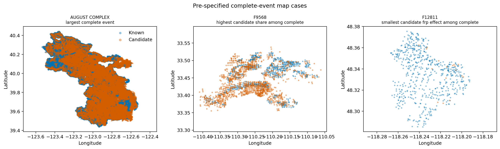
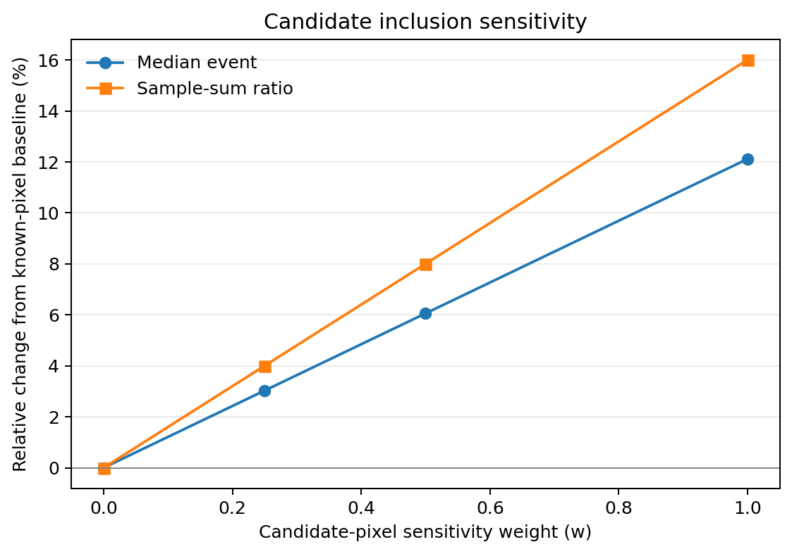
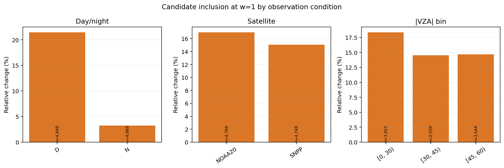
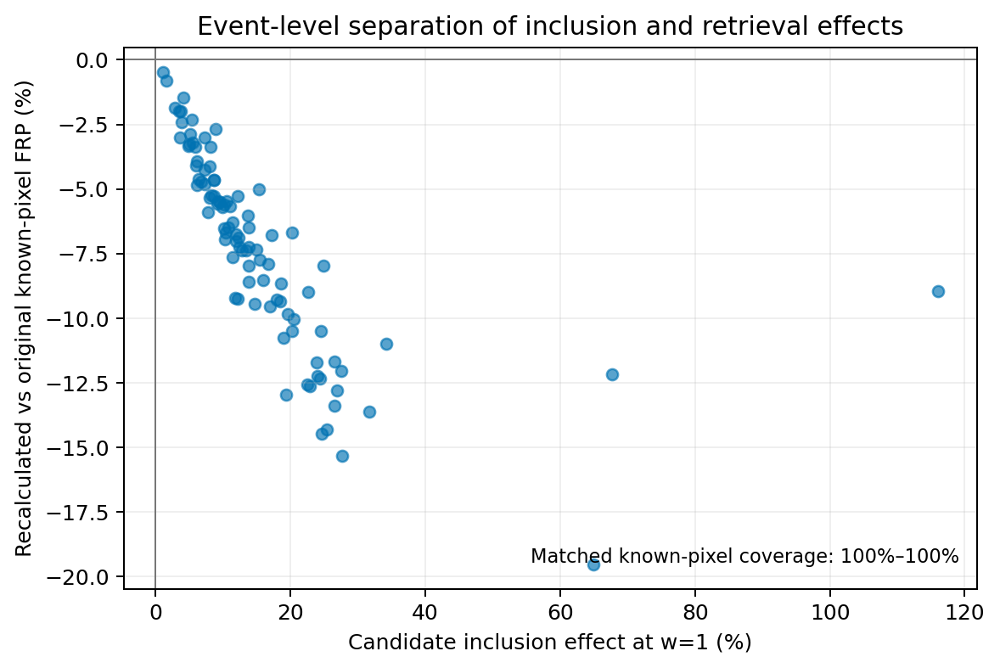

# VIIRS Candidate Fire Audit

An independent, reproducible sensitivity audit of the public 2020 VIIRS known
and candidate fire-pixel table released with Coffield et al. (2026). The audit
asks:

> How much does including author-selected candidate fire information change
> observed fire-activity summaries, and how much change instead comes from the
> recalculated FRP method?

This repository does **not** reimplement the VIIRS L1→L2 detector, train a fire
classifier, infer missing overpasses, or estimate future fire behavior. It is
not an EMBRS collaboration and does not imply review or endorsement by the lab,
the data authors, NASA, UBC, or the University of Maryland.

## Data

The source is `joined_dets_2020.parquet` from the University of Maryland
Digital Repository (DRUM):

- Dataset DOI: [`10.13016/evnn-j0zz`](https://doi.org/10.13016/evnn-j0zz)
- Related paper DOI: [`10.1016/j.rse.2025.115156`](https://doi.org/10.1016/j.rse.2025.115156)
- Data license stated by DRUM: CC0 1.0 Universal
- Downloaded file: 44,581,141 bytes
- SHA256: `c0695f44f8aa49e3db40bfc4517368d4b638dc9d1b1251874d9e632a81961416`

The raw file is excluded from version control. `data/manifest.json` records the
source URL, access time, checksum, license, DOIs, and software environment.
There is no synthetic fallback if download, licensing, checksum, or schema
validation fails.

## Empirical results

These are this repository's descriptive results from the public file retrieved
on 2026-09-15, not numbers copied from the paper:

| Quantity | Result |
|---|---:|
| Source pixel records | 873,862 |
| FEDS fire events | 95 |
| Fire × satellite × exact UTC observation groups | 9,518 |
| Known / candidate pixels | 706,876 / 166,986 |
| Exact duplicates, classification conflicts, negative FRP | 0 / 0 / 0 |
| Candidate-only observation groups | 661 |
| Candidate/known pixel-count ratio, day / night | 44.56% / 12.31% |
| Candidate inclusion at `w=1`, sample-sum FRP ratio | +16.01% |
| Candidate inclusion at `w=1`, median comparable observation | +0.68% |
| Candidate inclusion at `w=1`, day / night sample-sum ratio | +21.45% / +3.24% |
| Recalculated vs original FRP on matched known pixels | −8.18% |
| Combined recalculated known + candidates vs original known | +6.52% |

All 706,876 known pixels had both new and old FRP, so the retrieval comparison
coverage was 100% in this file. Across the 95 event-level inclusion ratios, the
mean was 15.65%; an event-resampling interval was 12.97%–18.80% (2,000
replicates, fixed seed). This interval describes between-event variation in
this sample, not candidate truth or representativeness of all fires.

The +16.01% inclusion effect and −8.18% retrieval effect use deliberately
separate denominators. Their combination is close to +6.52% relative to the
original-known-pixel sample sum. Keeping the terms separate is the point of the
audit: an aggregate net change alone cannot show which mechanism produced it.

`w` is a sensitivity weight, **not** a calibrated probability that a candidate
pixel is truly burning. Sample sums are arithmetic summaries of recorded
instantaneous FRP values; they are not FRE, daily energy, fuel consumption, or
emissions. Detection spans are spans between recorded detections, not
continuous burning durations. Without independent truth labels this repository
does not report precision or recall.

## Reproduce

Python 3.10+ is required. From the repository root:

```bash
python -m venv .venv
.venv\Scripts\activate
python -m pip install -e ".[dev]"
viirs-candidate-audit --root . download
viirs-candidate-audit --root . audit
viirs-candidate-audit --root . analyze
pytest
```

On macOS/Linux, activate with `source .venv/bin/activate`. To execute the whole
empirical workflow after installation:

```bash
viirs-candidate-audit --root . run
```

Generated evidence is written to:

- `outputs/quality_report.json`
- `outputs/analysis_summary.json`
- `outputs/observation_metrics.parquet`
- `outputs/event_metrics.csv`
- `outputs/strata_metrics.csv`
- `outputs/map_case_selection.csv`
- `outputs/figures/`

The compact generated outputs are intentionally suitable for version control
so a reviewer can inspect the evidence without rerunning the pipeline. Every
file can still be regenerated from the public source and configuration. The
44.6 MB raw source file remains excluded from version control.

## Design

The [research report](docs/research-report.md) summarizes the question and findings.
The [data management plan](docs/data-management.md) defines provenance, retention
and publication boundaries.

For known pixels \(K\) and author-selected candidate pixels \(C\) in one
observation group, both terms use the recalculated `frp` field:

\[
P^{(w)}=\sum_{i\in K}P_i^{new}+w\sum_{i\in C}P_i^{new},
\quad w\in\{0,0.25,0.5,1\}.
\]

The retrieval comparison uses only identical known pixels with both values:

\[
D_{retrieval}=\sum_{i\in K_*}P_i^{new}-\sum_{i\in K_*}P_i^{old}.
\]

See [methods](docs/methods.md) for grain, exclusions, stratification, event
resampling, and map-case selection. See [limitations](docs/limitations.md) for
the interpretation boundary.

## Figures

### Spatial comparison



### Candidate-weight sensitivity



### Observation conditions



### Inclusion versus retrieval effects



The workflow produces four static figures tied to the research question:

1. candidate-weight sensitivity;
2. day/night, satellite, and view-angle strata;
3. retrieval difference versus matched comparison coverage;
4. three mechanically selected complete-event maps, including a low-effect
   counterexample.

## Testing

Tests use small files and frames whose names explicitly include `synthetic`.
They cover UTC parsing, unknown and conflicting classifications, missing FRP,
all-missing groups, candidate-only groups, zero baselines, exact duplicates,
matched new/old FRP, `w=0` baseline identity, and monotonicity in `w` for fixed
non-negative samples. Synthetic fixtures are never accepted by the empirical
analysis reader.

## Citation and licenses

Code in this repository is MIT licensed. The downloaded data have their own
CC0 declaration on DRUM. Cite both the source paper and dataset when using the
analysis; machine-readable entries are in `docs/references.bib` and
`CITATION.cff`.
